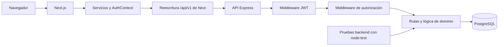
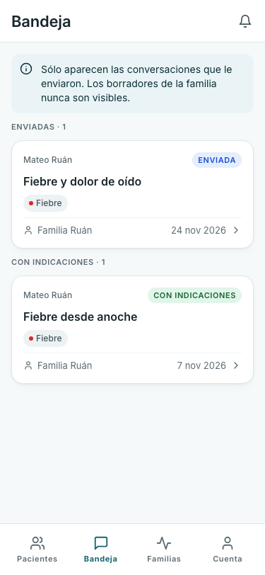
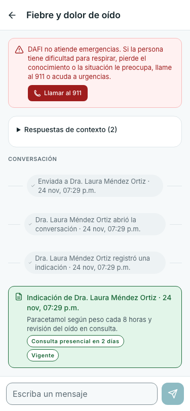
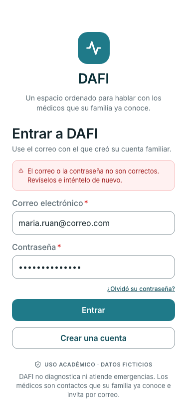

# DAFI

## Descripción del proyecto

DAFI es un proyecto académico para apoyar la coordinación de información entre cuidadores familiares y profesionales de salud. La aplicación organiza cuentas, perfiles y parte de la comunicación alrededor de una persona atendida. Su valor esperado es facilitar el intercambio de información estructurada; la implementación actual cubre solo una parte de ese flujo.

DAFI no diagnostica, no sustituye la valoración de un profesional y no reemplaza servicios de emergencia ni atención médica urgente. El repositorio y las demostraciones usan datos ficticios; no deben cargarse datos médicos reales.

## Funcionalidades implementadas

Todas las pantallas de esta tabla llaman al API de Express y guardan en PostgreSQL; ninguna usa datos fijos. Las rutas del backend están en [backend/src/routes/](backend/src/routes/) y las pantallas en [frontend/src/app/](frontend/src/app/).

| Quién | Funcionalidad | Pantalla | Endpoints principales |
|---|---|---|---|
| Familia | Crear cuenta (con aviso de privacidad) | `/crear-cuenta` | `POST /auth/register` |
| Todos | Iniciar sesión; los errores del backend se muestran en el formulario | `/entrar` | `POST /auth/login` |
| Familia | Perfiles: lista, crear, editar (alergias, medicamentos, tipo de sangre) y borrar con confirmación | `/perfiles`, `/perfiles/nuevo`, `/perfiles/{id}` | `GET/POST /familias/{id}/perfiles`, `GET/PATCH/DELETE /perfiles/{id}` |
| Familia | Nueva conversación con etiquetas, médica y prioridad | `/perfiles/{id}/conversaciones/nueva` | `GET /etiquetas`, `GET /familias/{id}/miembros`, `POST /perfiles/{id}/conversaciones` |
| Familia | Borrador: preguntas de contexto de «Fiebre» y «Piel», y envío | `/conversaciones/{id}/borrador` | `PUT /conversaciones/{id}/preguntas/{preguntaId}/respuesta`, `POST /conversaciones/{id}/envios` |
| Familia | Lista de conversaciones con filtro por estado, e hilo con indicaciones y mensajes | `/conversaciones`, `/conversaciones/{id}` | `GET /conversaciones`, `GET /conversaciones/{id}/eventos`, `POST /conversaciones/{id}/mensajes` |
| Médica | Bandeja por estado; al abrir una conversación enviada pasa a «En revisión» | `/medico/bandeja`, `/medico/conversaciones/{id}` | `GET /conversaciones`, `GET /conversaciones/{id}` |
| Médica | Registrar indicación y enviar mensajes | `/medico/conversaciones/{id}` | `POST /conversaciones/{id}/indicaciones`, `POST /conversaciones/{id}/mensajes` |
| Todos | Cerrar sesión (solo borra el token en el navegador; el backend no tiene endpoint para revocarlo) | `/cuenta`, `/medico/cuenta` | — |
| Familia | Pantalla informativa «Documentos», marcada como «Próximamente»; no guarda archivos | `/perfiles/{id}/documentos` | — |

Pendiente:

- Pantallas que solo explican lo que vendrá: `/circulo`, `/cuenta` (salvo cerrar sesión), `/medico/pacientes` y `/medico/familias`.
- No existen: fotos en la conversación, cerrar una conversación, solicitar información a la familia, invitaciones y consentimientos completos, recuperación de contraseña, notificaciones, resumen de contexto, reportes y despliegue público.

La clasificación de cada requisito funcional y su evidencia está en [S11_A1/matriz_trazabilidad.md](S11_A1/matriz_trazabilidad.md).

## Arquitectura



El navegador usa la aplicación Next.js. Los servicios y `AuthContext` gestionan las llamadas al API y la sesión; la reescritura de `/api/v1` hacia Express está configurada en [frontend/next.config.ts](frontend/next.config.ts) para mantener las solicitudes bajo el mismo origen. Express valida el JWT y aplica autorización antes de montar las rutas protegidas en [backend/src/app.js](backend/src/app.js). Las rutas acceden a PostgreSQL mediante `pg`; la suite backend usa `node:test`.

## Stack tecnológico

Versiones confirmadas en [backend/package.json](backend/package.json), [backend/package-lock.json](backend/package-lock.json), [frontend/package.json](frontend/package.json) y [frontend/package-lock.json](frontend/package-lock.json). Node/npm son requisitos derivados de las dependencias y del formato del lockfile; el proyecto no fija versiones mediante `engines`.

| Tecnología | Versión comprobada | Propósito |
|---|---|---|
| Node.js | `^20.19.0 || ^22.13.0 || >=24` | Runtime compatible con ESLint 10 del backend; Next.js requiere `>=20.9.0`. |
| npm | `>=9` compatible con lockfile v3; el repositorio no fija una versión exacta | Instalación reproducible desde los lockfiles. |
| PostgreSQL | 16 (versión indicada por el esquema) | Persistencia relacional. |
| Express | 5.3.0 | API HTTP del backend. |
| `pg` | 8.23.1 | Conexión del backend a PostgreSQL. |
| Next.js | 16.4.5 | Aplicación web y reescritura del API. |
| React / React DOM | 19.3.0 | Interfaz. |
| TypeScript | 5.9.3 | Tipado del frontend. |
| ESLint backend | 10.14.0 | Análisis estático de `src`, `scripts` y `test` del backend. |
| ESLint frontend | 9.39.5 | Análisis estático del frontend. |

## Estructura del repositorio

- [backend/](backend/) — API Express, pruebas, scripts, esquema/semillas de apoyo y colección Postman.
- [frontend/](frontend/) — aplicación Next.js y componentes de interfaz.
- [S03_A1/](S03_A1/) — SRS y backlog.
- [S05_S06_A1/](S05_S06_A1/) — OpenAPI, arquitectura y esquema de base de datos.
- [S05_S06_A2/](S05_S06_A2/) — evidencia y revisión de seguridad del backend.
- [S07_S08_A1/](S07_S08_A1/) — decisiones y revisión de componentes.
- [S07_S08_A2/](S07_S08_A2/) — evidencia de interfaz e integración.
- [S09_A1/](S09_A1/) — auditoría de calidad y deuda técnica.
- [S11_A1/](S11_A1/) — trazabilidad y retrospectiva.
- [docs/demo-final/](docs/demo-final/) — plan, tareas y lecciones de la demo final; [docs/capturas/](docs/capturas/) — capturas de este README.

## Requisitos previos

- Node.js en uno de los rangos compatibles indicados en la tabla de stack. ESLint 10 del backend requiere `^20.19.0 || ^22.13.0 || >=24`.
- npm 9 o posterior para trabajar con los lockfiles v3.
- PostgreSQL 16 para aplicar el esquema versionado.
- Git y una terminal Bash para los comandos de esta guía.

## Instalación local

### Clonar el repositorio

La URL termina en `TC5062-4.git`; Git crea por omisión el directorio `TC5062-4`, el nombre del repositorio sin el sufijo `.git`.

```bash
git clone https://github.com/CLA-TC5062-SN2026/TC5062-4.git
cd TC5062-4
```

### Configurar el entorno local

Desde la raíz del repositorio, copia las plantillas. El frontend lee `.env.local`, como indica su [archivo de ejemplo](frontend/.env.example).

```bash
cp backend/.env.example backend/.env
cp frontend/.env.example frontend/.env.local
```

Edita `backend/.env` localmente. Configura `DB_USER` para que coincida con el rol PostgreSQL, conserva `DB_NAME=dafi` si usas los comandos siguientes y establece `DB_PASSWORD` según la autenticación local. Configura `JWT_SECRET` con al menos 32 bytes aleatorios y `JWT_EXPIRATION`. No compartas ni versiones los archivos `.env`. La plantilla del backend está en [backend/.env.example](backend/.env.example).

Si usas PostgreSQL en Docker, sigue los pasos de [Aplicación en producción](#aplicación-en-producción) en lugar de las dos subsecciones siguientes: el contenedor ya crea el rol y la base, y `demo:reset` carga el esquema.

### Crear el rol y la base en una instalación inicial

Ejecuta estos comandos una sola vez, como administrador local de PostgreSQL, si el rol o la base todavía no existen. La herramienta de creación del rol solicita la contraseña de forma interactiva; no la incluyas en el comando. El ejemplo usa el rol `dafi_app`, que debe coincidir con `DB_USER` en `backend/.env`.

```bash
createuser --login --pwprompt dafi_app
createdb --owner=dafi_app dafi
```

Si el rol o la base ya existen, omite la creación del recurso correspondiente.

### Importar el esquema y los seeds SQL

Los valores de conexión siguientes corresponden a `DB_HOST`, `DB_PORT`, `DB_USER` y `DB_NAME` de [backend/.env.example](backend/.env.example); ajústalos para que coincidan con `backend/.env`. Se usan variables locales no sensibles. La opción `-W` del cliente PostgreSQL solicita la contraseña de forma interactiva, sin incluirla en el comando. Ejecuta este bloque desde la raíz, después de crear la base.

```bash
DB_HOST=localhost
DB_PORT=5432
DB_USER=dafi_app
DB_NAME=dafi

psql -W -v ON_ERROR_STOP=1 \
  -h "$DB_HOST" \
  -p "$DB_PORT" \
  -U "$DB_USER" \
  -d "$DB_NAME" \
  -f S05_S06_A1/esquema_bd.sql

psql -W -v ON_ERROR_STOP=1 \
  -h "$DB_HOST" \
  -p "$DB_PORT" \
  -U "$DB_USER" \
  -d "$DB_NAME" \
  -f backend/scripts/seed_demo.sql

psql -W -v ON_ERROR_STOP=1 \
  -h "$DB_HOST" \
  -p "$DB_PORT" \
  -U "$DB_USER" \
  -d "$DB_NAME" \
  -f backend/scripts/seed_auth_demo.sql
```

- [seed_demo.sql](backend/scripts/seed_demo.sql) carga datos ficticios de base para pruebas locales, incluidos usuarios y relaciones de demostración. Es opcional para iniciar la aplicación y sirve para escenarios de prueba con cuentas demo. Ejecútalo una vez después del esquema; sus inserciones usan `ON CONFLICT DO NOTHING`.
- [seed_auth_demo.sql](backend/scripts/seed_auth_demo.sql) agrega el aviso ficticio requerido por el registro demo con versión de aviso 1. Es opcional para iniciar la aplicación y necesario para ejecutar `seed_integracion_demo.mjs`. Ejecútalo una vez después del esquema y antes del seed de integración; también usa `ON CONFLICT DO NOTHING`.

Ambos archivos son exclusivamente locales; sus avisos y datos de demostración no deben usarse en producción.

### Instalar dependencias

Ejecuta desde la raíz. Cada instalación usa su lockfile y no depende del directorio actual de la terminal.

```bash
npm --prefix backend ci
npm --prefix frontend ci
```

### Reiniciar la base de demo (`demo:reset`)

**Este comando borra toda la base configurada en `backend/.env`** (elimina y recrea el esquema `public`) y la deja lista para la demo. No necesita el backend activo: levanta la API dentro del mismo proceso en un puerto libre. Ejecútalo desde la raíz:

```bash
npm --prefix backend run demo:reset
```

Se niega a correr con `NODE_ENV=production`. Si `DB_HOST` no es `localhost`, `127.0.0.1` ni `::1`, pide escribir el nombre de la base para confirmar y, sin terminal interactiva, no hace nada. La lógica está en [demo_seed.mjs](backend/scripts/demo_seed.mjs) y carga:

- el esquema, el aviso de privacidad ficticio versión 1 y el aviso de emergencias;
- la cuenta de María con la «Familia Ruán» y sus perfiles Mateo Ruán, María Ruán y Rosa Aguilar, creados mediante el API;
- la Dra. Laura Méndez Ortiz (Pediatría), activa y en el círculo de la familia;
- las etiquetas `fiebre`, `piel` y `respiratorio`, las preguntas de contexto F1, F2 y F3 de fiebre (F3, «¿Desde cuándo tiene fiebre?», se agregó para la demo y no está en el SRS) y P1, P2 y P3 de piel;
- una conversación de Mateo de hace unas dos semanas y media, ya con indicaciones, para que el historial no salga vacío.

Credenciales de demo, solo para uso local y con datos ficticios:

| Rol | Correo | Contraseña |
|---|---|---|
| Cuidadora principal | `maria.ruan@correo.com` | `DafiDemo2026!` |
| Médica | `laura.mendez@correo.com` | `DafiDemo2026!` |

Si el backend ya estaba corriendo, no hace falta reiniciarlo; las sesiones abiertas antes del reinicio dejan de ser válidas y hay que volver a entrar.

### Activar cuentas ficticias para pruebas de rol

[seed_medico_demo.mjs](backend/scripts/seed_medico_demo.mjs) activa el usuario médico ficticio creado por `seed_demo.sql`, por ejemplo, para probar una respuesta 403. [seed_cuidador_demo.mjs](backend/scripts/seed_cuidador_demo.mjs) activa el cuidador ficticio de la misma semilla para escenarios de regresión S09-A1. Son opcionales, solo locales, requieren las dependencias del backend, `backend/.env`, la base preparada y el seed base aplicado, y no necesitan ejecutarse en cada arranque. Ambos scripts bloquean su ejecución cuando `NODE_ENV` es `production`. Los bloques siguientes parten de la raíz y cambian a `backend` únicamente durante cada ejecución.

Desde la raíz, ejecuta cada bloque solo si necesitas habilitar la cuenta correspondiente:

```bash
(
  cd backend
  node scripts/seed_medico_demo.mjs
)
```

```bash
(
  cd backend
  node scripts/seed_cuidador_demo.mjs
)
```

La guía histórica de backend es [backend/README_backend_DAFI.md](backend/README_backend_DAFI.md).

## Variables de entorno

Las tablas reflejan únicamente [backend/.env.example](backend/.env.example) y [frontend/.env.example](frontend/.env.example). Los ejemplos son valores locales no sensibles; nunca configures secretos en variables `NEXT_PUBLIC_*`.

### Backend

| Variable | Finalidad | Requerida | Ejemplo no sensible |
|---|---|---|---|
| `PORT` | Puerto HTTP del API; default 4000 | No | `4000` |
| `DB_HOST` | Host PostgreSQL; default `localhost` | No | `localhost` |
| `DB_PORT` | Puerto PostgreSQL; default 5432 | No | `5432` |
| `DB_NAME` | Nombre de la base; default `dafi` | No | `dafi` |
| `DB_USER` | Usuario PostgreSQL para la conexión local | Sí para la configuración reproducible de esta guía | `dafi_app` |
| `DB_PASSWORD` | Contraseña PostgreSQL cuando la autenticación local la requiere | Depende de la autenticación local | Se configura localmente; no se publica |
| `JWT_SECRET` | Clave de firma JWT; el servidor exige al menos 32 bytes | Sí | Se genera y conserva solo en la configuración local |
| `JWT_EXPIRATION` | Duración de tokens JWT | Sí | `30m` |
| `MINUTOS_SESION` | Duración de sesión usada por reglas del backend | No | `30` |

### Frontend

| Variable | Finalidad | Requerida | Ejemplo no sensible |
|---|---|---|---|
| `NEXT_PUBLIC_API_URL` | Prefijo del API visible para el navegador | No; el ejemplo usa `/api/v1` | `/api/v1` |
| `BACKEND_URL` | Destino de la reescritura Next hacia Express | No; default local | `http://localhost:4000` |
| `NEXT_PUBLIC_APP_NAME` | Declarada en la plantilla para el nombre de la aplicación; el código actual no la consume | No | `DAFI` |

## Ejecución

### Backend (terminal 1)

Desde la raíz, inicia Express. El puerto predeterminado es 4000; `PORT` permite configurarlo ([backend/src/server.js](backend/src/server.js)).

```bash
npm --prefix backend run dev
```

### Datos para la integración visual (opcional)

[seed_integracion_demo.mjs](backend/scripts/seed_integracion_demo.mjs) crea, mediante el API, una cuidadora principal y tres perfiles ficticios. El script es local e idempotente; requiere el backend activo, la configuración `backend/.env` y el aviso local de `seed_auth_demo.sql`. Ejecútalo desde la raíz en otra terminal; el bloque entra a `backend` para que `dotenv` lea su configuración:

```bash
(
  cd backend
  node scripts/seed_integracion_demo.mjs
)
```

### Frontend (terminal 2)

Inicia Next.js desde la raíz. Usa el puerto 3000 por omisión; la reescritura `/api/v1` apunta a `BACKEND_URL`, cuyo valor predeterminado es `http://localhost:4000` ([frontend/next.config.ts](frontend/next.config.ts)).

```bash
npm --prefix frontend run dev
```

### Health check

El endpoint real es `GET /api/v1/health`, definido en [backend/src/app.js](backend/src/app.js):

```bash
curl http://localhost:4000/api/v1/health
```

## Pruebas y calidad

Ejecuta desde la raíz los scripts declarados en [backend/package.json](backend/package.json) y [frontend/package.json](frontend/package.json). Los números son los de `main` el 24 de noviembre de 2026.

| Suite | Comando | Pruebas | Necesita |
|---|---|---|---|
| Backend, unitarias (`node:test`) | `npm --prefix backend test` | 69 | Nada más |
| Backend, integración | `npm --prefix backend run test:integration` | 32 | PostgreSQL con la base `dafi_test` |
| Frontend, unitarias (Vitest) | `npm --prefix frontend test` | 55 | Nada más |
| Frontend, e2e (Playwright) | `npm --prefix frontend run e2e` (equivale a `npx playwright test` dentro de `frontend/`) | 60: 30 en `escritorio` y 30 en `movil` (375 × 812) | Stack corriendo y `demo:reset` |

Pruebas backend con `node:test`:

```bash
npm --prefix backend test
```

ESLint backend:

```bash
npm --prefix backend run lint
```

ESLint frontend:

```bash
npm --prefix frontend run lint
```

Build frontend y validaciones de Next.js/TypeScript (pasa en `main` el 24 de noviembre de 2026; córrelo con el servidor de desarrollo detenido):

```bash
npm --prefix frontend run build
```

Pruebas unitarias del frontend con Vitest:

```bash
npm --prefix frontend test
```

Pruebas e2e del frontend con Playwright ([frontend/e2e/](frontend/e2e/)), en Chromium de escritorio (`escritorio`) y en Chromium a 375 × 812 (`movil`). No arrancan servidores. Antes de correrlas:

1. PostgreSQL arriba, backend en :4000 y frontend en :3000 (ver [Aplicación en producción](#aplicación-en-producción)).
2. `npm --prefix backend run demo:reset`, porque cada corrida deja conversaciones nuevas en Mateo y, tras varias, una prueba deja de encontrar la conversación histórica.
3. La primera vez, instalar el navegador.

```bash
(cd frontend && npx playwright install chromium)
npm --prefix frontend run e2e
```

El guion completo de la demo (pasos 1 a 11 de [PLAN.md](docs/demo-final/PLAN.md), con una ventana para María y otra para la médica) está en [frontend/e2e/demo.spec.ts](frontend/e2e/demo.spec.ts). Para correr solo ese archivo:

```bash
npm --prefix frontend run e2e -- e2e/demo.spec.ts
```

No hay script de `typecheck`; el build es la validación disponible para TypeScript. No hay un script reproducible de Newman declarado en los manifests.

### Pruebas de integración

Las pruebas de [backend/integration/](backend/integration/) (archivos `*.int.mjs`) levantan la API en un puerto libre y la llaman con `fetch` contra una base PostgreSQL real. `npm --prefix backend test` no las ejecuta, así que sigue funcionando sin base de datos.

Crea una sola vez la base de prueba. Con el contenedor de Docker del proyecto:

```bash
docker exec dafi-postgres createdb -U dafi dafi_test
```

La conexión usa las variables `TEST_DB_HOST`, `TEST_DB_PORT`, `TEST_DB_USER`, `TEST_DB_PASSWORD` y `TEST_DB_NAME`. Si no se definen, toma host, puerto, usuario y contraseña de `DB_*` en `backend/.env`, y el nombre `dafi_test`; nunca usa `DB_NAME`. El arnés **se niega a correr** si el nombre de la base no termina en `_test`, porque borra y recrea el esquema `public` con [S05_S06_A1/esquema_bd.sql](S05_S06_A1/esquema_bd.sql) y el aviso de [seed_auth_demo.sql](backend/scripts/seed_auth_demo.sql) antes de cada archivo de prueba. Los usuarios que crea son ficticios (`@dafi.invalid`).

```bash
npm --prefix backend run test:integration
```

Para usar otra base de prueba, por ejemplo `TEST_DB_NAME=dafi_ci_test npm --prefix backend run test:integration`. Los ayudantes `crearCuidadora()`, `crearMedicaEnCirculo(familiaId)`, `login(correo)` y `api(ruta, opciones)` están en [backend/integration/arnes.mjs](backend/integration/arnes.mjs).

## API y documentación

- [SRS del equipo](S03_A1/SRS_equipo.md) y [backlog](S03_A1/backlog_completo.md).
- [Contrato OpenAPI](S05_S06_A1/openapi_equipo.yaml), [arquitectura](S05_S06_A1/arquitectura_equipo.md) y [esquema PostgreSQL](S05_S06_A1/esquema_bd.sql).
- [Revisión de seguridad](S05_S06_A2/revision_seguridad.md) y [revisión de componentes](S07_S08_A1/revision_componentes.md).
- [Auditoría de código](S09_A1/code_review.md), [clasificación de problemas](S09_A1/clasificacion_problemas.md), [salida ESLint](S09_A1/output_linter.txt) y [deuda técnica](S09_A1/deuda_tecnica.md).
- [Matriz de trazabilidad](S11_A1/matriz_trazabilidad.md) y [retrospectiva](S11_A1/retrospectiva_proyecto.md).

## Aplicación en producción

**No hay despliegue.** DAFI no está publicado en ninguna URL. La demo final (S11-A1) corre en local, en la máquina de un integrante, con PostgreSQL 16 en Docker y datos ficticios. Para reproducirla, desde la raíz del repositorio:

1. Levanta PostgreSQL 16 en Docker, publicado en el puerto 5434. Cambia `cambia_esta_clave` por una contraseña local tuya; no la versiones.

   ```bash
   docker run -d --name dafi-postgres \
     -e POSTGRES_USER=dafi \
     -e POSTGRES_PASSWORD=cambia_esta_clave \
     -e POSTGRES_DB=dafi \
     -p 5434:5432 postgres:16
   ```

   Si el contenedor ya existe, basta `docker start dafi-postgres`.

2. Crea `backend/.env` y `frontend/.env.local` desde sus plantillas ([Configurar el entorno local](#configurar-el-entorno-local)). En `backend/.env` usa `DB_PORT=5434`, `DB_USER=dafi`, `DB_NAME=dafi`, en `DB_PASSWORD` la misma contraseña del paso 1 y en `JWT_SECRET` un valor de al menos 32 bytes (por ejemplo, la salida de `openssl rand -hex 32`). El frontend funciona con los valores de la plantilla.

3. Instala dependencias:

   ```bash
   npm --prefix backend ci
   npm --prefix frontend ci
   ```

4. Carga los datos de demo. **Borra todo lo que haya en la base `dafi`** ([detalle](#reiniciar-la-base-de-demo-demoreset)).

   ```bash
   npm --prefix backend run demo:reset
   ```

5. Arranca el backend en :4000 (terminal 1) y el frontend en :3000 (terminal 2):

   ```bash
   npm --prefix backend run dev
   ```

   ```bash
   npm --prefix frontend run dev
   ```

6. Comprueba que el backend responde con `curl http://localhost:4000/api/v1/health` y abre `http://localhost:3000/entrar`.

7. Entra con las dos cuentas de demo de la tabla de [credenciales](#reiniciar-la-base-de-demo-demoreset): María (cuidadora principal) en una ventana normal y la Dra. Laura Méndez (médica) en una de incógnito, para no cerrar sesión a cada paso. El guion de la demo está en [PLAN.md](docs/demo-final/PLAN.md), sección 3.

`demo:reset` cierra las sesiones abiertas: después de cada reinicio hay que volver a entrar con las dos cuentas.

## Capturas de pantalla

Capturas de la versión de la demo final a 375 × 812 (ancho de teléfono), con los datos ficticios de `demo:reset`. Las de S07-S08 siguen en [S07_S08_A2/evidencia/](S07_S08_A2/evidencia/).







## Estado funcional y limitaciones

El flujo completo de la demo funciona de punta a punta contra Express y PostgreSQL: la familia crea perfiles y abre una conversación, responde el contexto y la envía; la médica la ve en su bandeja, la abre y registra una indicación; la familia la lee en el hilo y contesta. Lo que falta está en [Funcionalidades implementadas](#funcionalidades-implementadas). Otras limitaciones conocidas:

- Cerrar sesión no revoca el token en el backend; la sesión caduca por inactividad a los 30 minutos (`MINUTOS_SESION`).
- Borrar un perfil borra también sus conversaciones y la bitácora de accesos de esas conversaciones.
- El historial de un perfil se pagina por fecha de creación, no por última actividad.
- No hay URL pública de producción.

Las particularidades encontradas durante el desarrollo están en [LESSONS.md](docs/demo-final/LESSONS.md).

PostgreSQL es la base de datos implementada y vigente. El SRS conserva una referencia histórica a MongoDB que constituye una inconsistencia documental.

## Seguridad y datos

- Usa exclusivamente datos ficticios en las semillas, pruebas y capturas. No introduzcas datos médicos reales.
- Los archivos `backend/.env` y `frontend/.env.local` son configuración local y no deben versionarse.
- El backend exige un secreto JWT local de al menos 32 bytes. No publiques tokens ni secretos ni los incluyas en capturas o reportes.
- Las rutas protegidas usan JWT y middleware de autorización por rol; esto no acredita que toda regla del OpenAPI esté implementada.
- Este repositorio tiene propósito académico y no constituye un servicio clínico o de emergencia.

## Equipo y documentación

Proyecto académico del Equipo 4 (TC5062). Integrantes, tal como aparecen en los documentos de equipo (por ejemplo, [SRS_equipo.md](S03_A1/SRS_equipo.md)):

- Armando Arredondo Valle (A01424709)
- Isaac González Trejo (A01274193)
- Francisco Martínez Álvarez (A01840483)
- Daniel Ruán Aguilar (A01731921)

Este README no asigna cargos.

Documentación vigente:

- [Plan de la demo final](docs/demo-final/PLAN.md), [tareas](docs/demo-final/TASKS.md) y [lecciones](docs/demo-final/LESSONS.md).
- [Matriz de trazabilidad](S11_A1/matriz_trazabilidad.md) y [retrospectiva del proyecto](S11_A1/retrospectiva_proyecto.md).
- [Contrato OpenAPI](S05_S06_A1/openapi_equipo.yaml) y [SRS del equipo](S03_A1/SRS_equipo.md).

El resto de la documentación de las actividades se enlaza en [API y documentación](#api-y-documentación).
