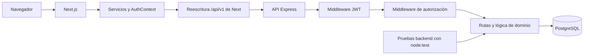
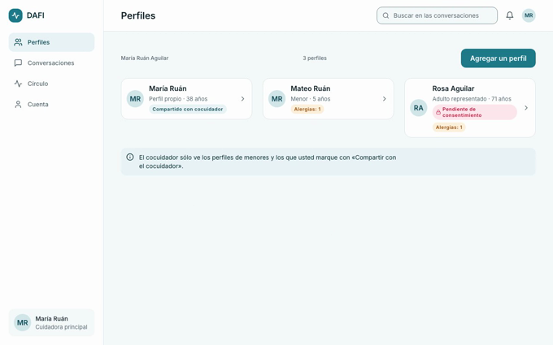
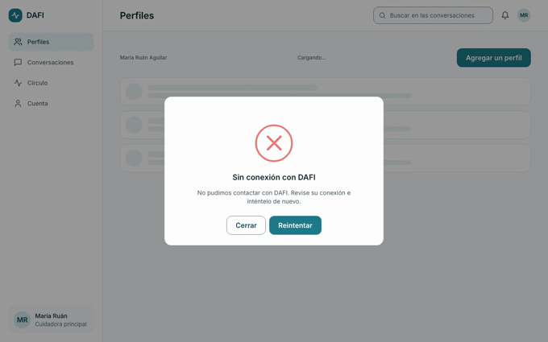

# DAFI

## Descripción del proyecto

DAFI es un proyecto académico para apoyar la coordinación de información entre cuidadores familiares y profesionales de salud. La aplicación organiza cuentas, perfiles y parte de la comunicación alrededor de una persona atendida. Su valor esperado es facilitar el intercambio de información estructurada; la implementación actual cubre solo una parte de ese flujo.

DAFI no diagnostica, no sustituye la valoración de un profesional y no reemplaza servicios de emergencia ni atención médica urgente. El repositorio y las demostraciones usan datos ficticios; no deben cargarse datos médicos reales.

## Funcionalidades implementadas

| Estado | Alcance comprobable |
|---|---|
| Implementado en backend | API Express con registro e inicio de sesión JWT, consulta de usuario autenticado, autorización por roles y operaciones de perfil y conversación respaldadas por PostgreSQL. La cobertura de cada flujo respecto al OpenAPI es parcial. |
| Integración frontend/backend | El inicio de sesión y el listado de perfiles tienen integración documentada. La autenticación y los controles de acceso también cuentan con revisión y evidencia de solicitudes seleccionadas. |
| Parcialmente implementado | Los flujos backend de conversaciones, mensajes y eventos cubren parte del contrato; faltan criterios y transiciones, incluidos consentimiento completo, recuperación de cuenta, fotos, notificaciones y cierre. |
| Prototipo visual | Vistas de nueva conversación, hilo, bandeja e historial consumen [`frontend/src/lib/datos-demo.ts`](frontend/src/lib/datos-demo.ts) en partes importantes. Los fixtures no representan integración real con el API. |
| No implementado | No hay módulo funcional de resumen de contexto, entrega de notificaciones, administración de reportes ni despliegue público documentado. |

La matriz S11 clasifica los 23 requisitos funcionales como 0 completos, 17 parcialmente implementados, 6 no implementados y 0 no aplica. La clasificación y sus evidencias están en [S11_A1/matriz_trazabilidad.md](S11_A1/matriz_trazabilidad.md).

## Arquitectura



El navegador usa la aplicación Next.js. Los servicios y `AuthContext` gestionan las llamadas al API y la sesión; la reescritura de `/api/v1` hacia Express está configurada en [frontend/next.config.ts](frontend/next.config.ts) para mantener las solicitudes bajo el mismo origen. Express valida el JWT y aplica autorización antes de montar las rutas protegidas en [backend/src/app.js](backend/src/app.js). Las rutas acceden a PostgreSQL mediante `pg`; la suite backend usa `node:test`.

## Stack tecnológico

Versiones confirmadas en [backend/package.json](backend/package.json), [backend/package-lock.json](backend/package-lock.json), [frontend/package.json](frontend/package.json) y [frontend/package-lock.json](frontend/package-lock.json). Node/npm son requisitos derivados de las dependencias y del formato del lockfile; el proyecto no fija versiones mediante `engines`.

| Tecnología | Versión comprobada | Propósito |
|---|---|---|
| Node.js | `^20.19.0 || ^22.13.0 || >=24` | Runtime compatible con ESLint 10 del backend; Next.js requiere `>=20.9.0`. |
| npm | `>=9` compatible con lockfile v3; el repositorio no fija una versión exacta | Instalación reproducible desde los lockfiles. |
| PostgreSQL | 16 (versión indicada por el esquema) | Persistencia relacional. |
| Express | 5.3.0 | API HTTP del backend. |
| `pg` | 8.23.1 | Conexión del backend a PostgreSQL. |
| Next.js | 16.4.5 | Aplicación web y reescritura del API. |
| React / React DOM | 19.3.0 | Interfaz. |
| TypeScript | 5.9.3 | Tipado del frontend. |
| ESLint backend | 10.14.0 | Análisis estático de `src`, `scripts` y `test` del backend. |
| ESLint frontend | 9.39.5 | Análisis estático del frontend. |

## Estructura del repositorio

- [backend/](backend/) — API Express, pruebas, scripts, esquema/semillas de apoyo y colección Postman.
- [frontend/](frontend/) — aplicación Next.js y componentes de interfaz.
- [S03_A1/](S03_A1/) — SRS y backlog.
- [S05_S06_A1/](S05_S06_A1/) — OpenAPI, arquitectura y esquema de base de datos.
- [S05_S06_A2/](S05_S06_A2/) — evidencia y revisión de seguridad del backend.
- [S07_S08_A1/](S07_S08_A1/) — decisiones y revisión de componentes.
- [S07_S08_A2/](S07_S08_A2/) — evidencia de interfaz e integración.
- [S09_A1/](S09_A1/) — auditoría de calidad y deuda técnica.
- [S11_A1/](S11_A1/) — trazabilidad y retrospectiva.

## Requisitos previos

- Node.js en uno de los rangos compatibles indicados en la tabla de stack. ESLint 10 del backend requiere `^20.19.0 || ^22.13.0 || >=24`.
- npm 9 o posterior para trabajar con los lockfiles v3.
- PostgreSQL 16 para aplicar el esquema versionado.
- Git y una terminal Bash para los comandos de esta guía.

## Instalación local

### Clonar el repositorio

La URL termina en `TC5062-4.git`; Git crea por omisión el directorio `TC5062-4`, el nombre del repositorio sin el sufijo `.git`.

```bash
git clone https://github.com/CLA-TC5062-SN2026/TC5062-4.git
cd TC5062-4
```

### Configurar el entorno local

Desde la raíz del repositorio, copia las plantillas. El frontend lee `.env.local`, como indica su [archivo de ejemplo](frontend/.env.example).

```bash
cp backend/.env.example backend/.env
cp frontend/.env.example frontend/.env.local
```

Edita `backend/.env` localmente. Configura `DB_USER` para que coincida con el rol PostgreSQL, conserva `DB_NAME=dafi` si usas los comandos siguientes y establece `DB_PASSWORD` según la autenticación local. Configura `JWT_SECRET` con al menos 32 bytes aleatorios y `JWT_EXPIRATION`. No compartas ni versiones los archivos `.env`. La plantilla del backend está en [backend/.env.example](backend/.env.example).

### Crear el rol y la base en una instalación inicial

Ejecuta estos comandos una sola vez, como administrador local de PostgreSQL, si el rol o la base todavía no existen. La herramienta de creación del rol solicita la contraseña de forma interactiva; no la incluyas en el comando. El ejemplo usa el rol `dafi_app`, que debe coincidir con `DB_USER` en `backend/.env`.

```bash
createuser --login --pwprompt dafi_app
createdb --owner=dafi_app dafi
```

Si el rol o la base ya existen, omite la creación del recurso correspondiente.

### Importar el esquema y los seeds SQL

Los valores de conexión siguientes corresponden a `DB_HOST`, `DB_PORT`, `DB_USER` y `DB_NAME` de [backend/.env.example](backend/.env.example); ajústalos para que coincidan con `backend/.env`. Se usan variables locales no sensibles. La opción `-W` del cliente PostgreSQL solicita la contraseña de forma interactiva, sin incluirla en el comando. Ejecuta este bloque desde la raíz, después de crear la base.

```bash
DB_HOST=localhost
DB_PORT=5432
DB_USER=dafi_app
DB_NAME=dafi

psql -W -v ON_ERROR_STOP=1 \
  -h "$DB_HOST" \
  -p "$DB_PORT" \
  -U "$DB_USER" \
  -d "$DB_NAME" \
  -f S05_S06_A1/esquema_bd.sql

psql -W -v ON_ERROR_STOP=1 \
  -h "$DB_HOST" \
  -p "$DB_PORT" \
  -U "$DB_USER" \
  -d "$DB_NAME" \
  -f backend/scripts/seed_demo.sql

psql -W -v ON_ERROR_STOP=1 \
  -h "$DB_HOST" \
  -p "$DB_PORT" \
  -U "$DB_USER" \
  -d "$DB_NAME" \
  -f backend/scripts/seed_auth_demo.sql
```

- [seed_demo.sql](backend/scripts/seed_demo.sql) carga datos ficticios de base para pruebas locales, incluidos usuarios y relaciones de demostración. Es opcional para iniciar la aplicación y sirve para escenarios de prueba con cuentas demo. Ejecútalo una vez después del esquema; sus inserciones usan `ON CONFLICT DO NOTHING`.
- [seed_auth_demo.sql](backend/scripts/seed_auth_demo.sql) agrega el aviso ficticio requerido por el registro demo con versión de aviso 1. Es opcional para iniciar la aplicación y necesario para ejecutar `seed_integracion_demo.mjs`. Ejecútalo una vez después del esquema y antes del seed de integración; también usa `ON CONFLICT DO NOTHING`.

Ambos archivos son exclusivamente locales; sus avisos y datos de demostración no deben usarse en producción.

### Instalar dependencias

Ejecuta desde la raíz. Cada instalación usa su lockfile y no depende del directorio actual de la terminal.

```bash
npm --prefix backend ci
npm --prefix frontend ci
```

### Reiniciar la base de demo (`demo:reset`)

**Este comando borra toda la base configurada en `backend/.env`** (elimina y recrea el esquema `public`) y la deja lista para la demo. No necesita el backend activo: levanta la API dentro del mismo proceso en un puerto libre. Ejecútalo desde la raíz:

```bash
npm --prefix backend run demo:reset
```

Se niega a correr con `NODE_ENV=production`. Si `DB_HOST` no es `localhost`, `127.0.0.1` ni `::1`, pide escribir el nombre de la base para confirmar y, sin terminal interactiva, no hace nada. La lógica está en [demo_seed.mjs](backend/scripts/demo_seed.mjs) y carga:

- el esquema, el aviso de privacidad ficticio versión 1 y el aviso de emergencias;
- la cuenta de María con la «Familia Ruán» y sus perfiles Mateo Ruán, María Ruán y Rosa Aguilar, creados mediante el API;
- la Dra. Laura Méndez Ortiz (Pediatría), activa y en el círculo de la familia;
- las etiquetas `fiebre`, `piel` y `respiratorio` y las preguntas de contexto F1, F2 y F3 de fiebre (F3, «¿Desde cuándo tiene fiebre?», se agregó para la demo y no está en el SRS);
- una conversación de Mateo de hace unas dos semanas y media, ya con indicaciones, para que el historial no salga vacío.

Credenciales de demo, solo para uso local y con datos ficticios:

| Rol | Correo | Contraseña |
|---|---|---|
| Cuidadora principal | `maria.ruan@correo.com` | `DafiDemo2026!` |
| Médica | `laura.mendez@correo.com` | `DafiDemo2026!` |

Si el backend ya estaba corriendo, no hace falta reiniciarlo; las sesiones abiertas antes del reinicio dejan de ser válidas y hay que volver a entrar.

### Activar cuentas ficticias para pruebas de rol

[seed_medico_demo.mjs](backend/scripts/seed_medico_demo.mjs) activa el usuario médico ficticio creado por `seed_demo.sql`, por ejemplo, para probar una respuesta 403. [seed_cuidador_demo.mjs](backend/scripts/seed_cuidador_demo.mjs) activa el cuidador ficticio de la misma semilla para escenarios de regresión S09-A1. Son opcionales, solo locales, requieren las dependencias del backend, `backend/.env`, la base preparada y el seed base aplicado, y no necesitan ejecutarse en cada arranque. Ambos scripts bloquean su ejecución cuando `NODE_ENV` es `production`. Los bloques siguientes parten de la raíz y cambian a `backend` únicamente durante cada ejecución.

Desde la raíz, ejecuta cada bloque solo si necesitas habilitar la cuenta correspondiente:

```bash
(
  cd backend
  node scripts/seed_medico_demo.mjs
)
```

```bash
(
  cd backend
  node scripts/seed_cuidador_demo.mjs
)
```

La guía histórica de backend es [backend/README_backend_DAFI.md](backend/README_backend_DAFI.md).

## Variables de entorno

Las tablas reflejan únicamente [backend/.env.example](backend/.env.example) y [frontend/.env.example](frontend/.env.example). Los ejemplos son valores locales no sensibles; nunca configures secretos en variables `NEXT_PUBLIC_*`.

### Backend

| Variable | Finalidad | Requerida | Ejemplo no sensible |
|---|---|---|---|
| `PORT` | Puerto HTTP del API; default 4000 | No | `4000` |
| `DB_HOST` | Host PostgreSQL; default `localhost` | No | `localhost` |
| `DB_PORT` | Puerto PostgreSQL; default 5432 | No | `5432` |
| `DB_NAME` | Nombre de la base; default `dafi` | No | `dafi` |
| `DB_USER` | Usuario PostgreSQL para la conexión local | Sí para la configuración reproducible de esta guía | `dafi_app` |
| `DB_PASSWORD` | Contraseña PostgreSQL cuando la autenticación local la requiere | Depende de la autenticación local | Se configura localmente; no se publica |
| `JWT_SECRET` | Clave de firma JWT; el servidor exige al menos 32 bytes | Sí | Se genera y conserva solo en la configuración local |
| `JWT_EXPIRATION` | Duración de tokens JWT | Sí | `30m` |
| `MINUTOS_SESION` | Duración de sesión usada por reglas del backend | No | `30` |

### Frontend

| Variable | Finalidad | Requerida | Ejemplo no sensible |
|---|---|---|---|
| `NEXT_PUBLIC_API_URL` | Prefijo del API visible para el navegador | No; el ejemplo usa `/api/v1` | `/api/v1` |
| `BACKEND_URL` | Destino de la reescritura Next hacia Express | No; default local | `http://localhost:4000` |
| `NEXT_PUBLIC_APP_NAME` | Declarada en la plantilla para el nombre de la aplicación; el código actual no la consume | No | `DAFI` |

## Ejecución

### Backend (terminal 1)

Desde la raíz, inicia Express. El puerto predeterminado es 4000; `PORT` permite configurarlo ([backend/src/server.js](backend/src/server.js)).

```bash
npm --prefix backend run dev
```

### Datos para la integración visual (opcional)

[seed_integracion_demo.mjs](backend/scripts/seed_integracion_demo.mjs) crea, mediante el API, una cuidadora principal y tres perfiles ficticios. El script es local e idempotente; requiere el backend activo, la configuración `backend/.env` y el aviso local de `seed_auth_demo.sql`. Ejecútalo desde la raíz en otra terminal; el bloque entra a `backend` para que `dotenv` lea su configuración:

```bash
(
  cd backend
  node scripts/seed_integracion_demo.mjs
)
```

### Frontend (terminal 2)

Inicia Next.js desde la raíz. Usa el puerto 3000 por omisión; la reescritura `/api/v1` apunta a `BACKEND_URL`, cuyo valor predeterminado es `http://localhost:4000` ([frontend/next.config.ts](frontend/next.config.ts)).

```bash
npm --prefix frontend run dev
```

### Health check

El endpoint real es `GET /api/v1/health`, definido en [backend/src/app.js](backend/src/app.js):

```bash
curl http://localhost:4000/api/v1/health
```

## Pruebas y calidad

Ejecuta desde la raíz los scripts declarados en [backend/package.json](backend/package.json) y [frontend/package.json](frontend/package.json).

Pruebas backend con `node:test`:

```bash
npm --prefix backend test
```

ESLint backend:

```bash
npm --prefix backend run lint
```

ESLint frontend:

```bash
npm --prefix frontend run lint
```

Build frontend y validaciones de Next.js/TypeScript:

```bash
npm --prefix frontend run build
```

El frontend no declara un script separado de pruebas ni de `typecheck`; el build es la validación disponible para TypeScript. No hay un script reproducible de Newman declarado en los manifests. Estos comandos describen cómo ejecutar las comprobaciones; no afirman que se hayan ejecutado o aprobado en esta revisión.

### Pruebas de integración

Las pruebas de [backend/integration/](backend/integration/) (archivos `*.int.mjs`) levantan la API en un puerto libre y la llaman con `fetch` contra una base PostgreSQL real. `npm --prefix backend test` no las ejecuta, así que sigue funcionando sin base de datos.

Crea una sola vez la base de prueba. Con el contenedor de Docker del proyecto:

```bash
docker exec dafi-postgres createdb -U dafi dafi_test
```

La conexión usa las variables `TEST_DB_HOST`, `TEST_DB_PORT`, `TEST_DB_USER`, `TEST_DB_PASSWORD` y `TEST_DB_NAME`. Si no se definen, toma host, puerto, usuario y contraseña de `DB_*` en `backend/.env`, y el nombre `dafi_test`; nunca usa `DB_NAME`. El arnés **se niega a correr** si el nombre de la base no termina en `_test`, porque borra y recrea el esquema `public` con [S05_S06_A1/esquema_bd.sql](S05_S06_A1/esquema_bd.sql) y el aviso de [seed_auth_demo.sql](backend/scripts/seed_auth_demo.sql) antes de cada archivo de prueba. Los usuarios que crea son ficticios (`@dafi.invalid`).

```bash
npm --prefix backend run test:integration
```

Para usar otra base de prueba, por ejemplo `TEST_DB_NAME=dafi_ci_test npm --prefix backend run test:integration`. Los ayudantes `crearCuidadora()`, `crearMedicaEnCirculo(familiaId)`, `login(correo)` y `api(ruta, opciones)` están en [backend/integration/arnes.mjs](backend/integration/arnes.mjs).

## API y documentación

- [SRS del equipo](S03_A1/SRS_equipo.md) y [backlog](S03_A1/backlog_completo.md).
- [Contrato OpenAPI](S05_S06_A1/openapi_equipo.yaml), [arquitectura](S05_S06_A1/arquitectura_equipo.md) y [esquema PostgreSQL](S05_S06_A1/esquema_bd.sql).
- [Revisión de seguridad](S05_S06_A2/revision_seguridad.md) y [revisión de componentes](S07_S08_A1/revision_componentes.md).
- [Auditoría de código](S09_A1/code_review.md), [clasificación de problemas](S09_A1/clasificacion_problemas.md), [salida ESLint](S09_A1/output_linter.txt) y [deuda técnica](S09_A1/deuda_tecnica.md).
- [Matriz de trazabilidad](S11_A1/matriz_trazabilidad.md) y [retrospectiva](S11_A1/retrospectiva_proyecto.md).

## Aplicación en producción

## Capturas de pantalla

Las capturas versionadas muestran una condición de error de interfaz y un listado de tres perfiles ficticios servidos por PostgreSQL; no representan una publicación en producción.





## Estado funcional y limitaciones

El producto implementa autenticación y algunas operaciones de perfiles y conversaciones en el backend. La integración demostrada en frontend se limita al inicio de sesión y al listado de perfiles. Las vistas de conversación, bandeja e historial contienen fixtures y son prototipos visuales; no equivalen a persistencia ni a integración con Express. La cobertura del OpenAPI, los criterios de aceptación y las pruebas es parcial. No están implementados flujos completos de consentimiento, recuperación de cuenta, fotos, notificaciones, reportes ni resumen de contexto. No hay URL pública de producción documentada.

PostgreSQL es la base de datos implementada y vigente. El SRS conserva una referencia histórica a MongoDB que constituye una inconsistencia documental.

## Seguridad y datos

- Usa exclusivamente datos ficticios en las semillas, pruebas y capturas. No introduzcas datos médicos reales.
- Los archivos `backend/.env` y `frontend/.env.local` son configuración local y no deben versionarse.
- El backend exige un secreto JWT local de al menos 32 bytes. No publiques tokens ni secretos ni los incluyas en capturas o reportes.
- Las rutas protegidas usan JWT y middleware de autorización por rol; esto no acredita que toda regla del OpenAPI esté implementada.
- Este repositorio tiene propósito académico y no constituye un servicio clínico o de emergencia.

## Equipo y documentación

Proyecto académico del Equipo 4. La lista de integrantes y las actividades están en los documentos versionados; este README no asigna cargos. La documentación del producto y de las actividades se enlaza en [API y documentación](#api-y-documentación), y la trazabilidad y retrospectiva actuales están en [S11_A1](S11_A1/).
