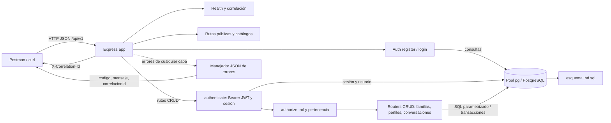

# Arquitectura consolidada del equipo

## 1. Propósito y alcance

Este documento describe la arquitectura realmente implementada en el repositorio para las actividades S05-S06-A1 y A2. El backend es una API REST académica local de DAFI, construida con Express y PostgreSQL. A2 añade autenticación JWT, validación de sesiones y autorización por roles a los CRUD implementados en A1. La implementación no cubre todas las operaciones del OpenAPI ni debe usarse con datos reales o exponerse como servicio de producción.

## 2. Decisiones tecnológicas

- **Node.js y ES modules:** runtime del backend (`backend/package.json`, `type: module`).
- **Express 5:** composición HTTP, rutas REST, parsing JSON y middleware.
- **PostgreSQL:** persistencia relacional descrita en `S05_S06_A1/esquema_bd.sql`.
- **`pg`:** pool y consultas parametrizadas desde `backend/src/config/database.js`.
- **`dotenv`:** lectura local de configuración por el proceso del servidor.
- **`bcryptjs`:** hash y comparación de contraseñas.
- **`jsonwebtoken`:** emisión/verificación JWT HS256 con issuer, audience y expiración.
- **Postman y curl:** clientes para ejecutar solicitudes y observar respuestas; colecciones en `backend/postman/`.

## 3. Componentes

- **Cliente/API consumer:** Postman o `curl` envían HTTP/JSON al prefijo `/api/v1`.
- **Aplicación Express (`backend/src/app.js`):** habilita CORS, asigna `X-Correlation-Id`, limita el parser JSON a 1 MB, monta rutas y el manejador de errores.
- **Rutas públicas:** health, catálogos y rutas `register`/`login`.
- **Autenticación:** `backend/src/routes/auth.js` implementa `POST /auth/register`, `POST /auth/login` y `GET /auth/me`.
- **`authenticate`:** valida Bearer JWT, claims, sesión activa, usuario y actividad en PostgreSQL; adjunta identidad verificada a `req.auth`.
- **`authorize`:** verifica roles y pertenencia/visibilidad del recurso para las rutas CRUD.
- **Routers CRUD:** familias, perfiles y conversaciones en `backend/src/routes/`.
- **Pool PostgreSQL:** centraliza acceso mediante `pg`; las operaciones con varios pasos usan transacciones donde corresponde.
- **Persistencia:** esquema SQL consolidado y scripts locales de datos ficticios en `backend/scripts/`.
- **Errores:** middleware final devuelve JSON con `codigo`, `mensaje` y `correlacionId`; respuestas 5xx no revelan el detalle al cliente.
- **Configuración:** `backend/.env.example` enumera `PORT`, `DB_HOST`, `DB_PORT`, `DB_NAME`, `DB_USER`, `DB_PASSWORD`, `JWT_SECRET`, `JWT_EXPIRATION` y `MINUTOS_SESION`. No guardar `.env` en Git.

## 4. Diagrama Mermaid

## 5. Flujo de autenticación

1. El cliente envía `POST /api/v1/auth/register` con cuenta, consentimiento y versión del aviso; el backend valida campos, comprueba unicidad y almacena hash bcryptjs en una transacción. La respuesta pública no incluye contraseña ni hash.
2. El cliente usa `POST /api/v1/auth/login`. El backend consulta usuario, compara bcrypt, firma JWT HS256 con `sub`, `rol`, `familiaId`, `jti`, issuer, audience y expiración; también registra la sesión en PostgreSQL. Credenciales incorrectas responden 401.
3. El cliente envía `Authorization: Bearer <token>` a `/api/v1/auth/me` o un CRUD. `authenticate` verifica firma y claims, vigencia, sesión, estado del usuario y tiempo de inactividad. No se documenta ni imprime el token.
4. En CRUD, `authorize` comprueba el rol y la propiedad/visibilidad del recurso; rol insuficiente responde 403 y recurso ajeno/no encontrado puede responder 404.

## 6. Flujo CRUD protegido

Las rutas públicas se montan antes de la cadena protegida. Para familias, perfiles y conversaciones, `app.use("/api/v1", authenticate, authorize, familias, perfiles, conversaciones)` exige autenticación y autorización antes del router. Las solicitudes usan UUID y validaciones de campos; lecturas devuelven JSON, los POST de creación observados devuelven 201, PATCH devuelve 200 y DELETE devuelve 204 cuando el recurso se elimina. La evidencia de A2 verifica CRUD de perfiles con token, persistencia POST→GET, actualización PATCH y borrado controlado.

## 7. Persistencia

PostgreSQL almacena usuarios, familias, perfiles, conversaciones, sesiones y relaciones definidas en el esquema de A1. `pg.Pool` se configura con host, puerto y base de datos por entorno y usa timeouts. El esquema y los seeds son scripts SQL/Node para una base local de prueba; deben aplicarse solo conforme a su estado y no repetirse sobre tablas existentes. Las pruebas funcionales registradas usan datos ficticios.

## 8. Seguridad

- Hash de contraseña con bcryptjs; comparación mediante `bcrypt.compare`.
- JWT con secret por entorno, HS256, `issuer`, `audience`, expiración y `jti` relacionado con una sesión de base de datos.
- `authenticate` distingue ausencia/token inválido/expirado como 401; `authorize` deniega rol con 403 y limita recursos por familia/visibilidad.
- Respuestas públicas de cuenta no incluyen contraseña ni hash; el manejador evita devolver detalles internos 5xx.
- `cors()` está abierto en la configuración observada; es aceptable únicamente para el uso local académico documentado, no para producción.
- No se observó rate limiting de login en la ruta actual. No exponer el backend públicamente ni usar información real.

## 9. Trazabilidad

- `S05_S06_A1/openapi_equipo.yaml`: contrato REST y esquema Bearer global con excepciones públicas declaradas.
- `S05_S06_A1/diagrama_clases_equipo.puml`: diseño de clases/dominio consolidado.
- `S05_S06_A1/esquema_bd.sql`: definición de PostgreSQL.
- `backend/src/app.js`: montaje de middleware y routers.
- `backend/src/routes/`: operaciones HTTP implementadas.
- `backend/src/middleware/`: autenticación y autorización A2.
- `backend/src/config/database.js` y `backend/src/utils/http.js`: acceso a datos, errores y transacciones.
- `S05_S06_A2/evidencia/pruebas_terminal_daniel.md`: resultados sanitizados de las pruebas funcionales locales realizadas con curl.

El OpenAPI contiene operaciones que no están implementadas en el backend actual. La presencia de una operación en el contrato no implica que su endpoint esté disponible.

## 10. Despliegue local

- API: `http://localhost:4000/api/v1` por defecto; health en `/api/v1/health`.
- Requiere Node.js/npm y PostgreSQL local con base de prueba `dafi`.
- Configurar `.env` desde `.env.example`, sin versionarlo. Los puertos de PostgreSQL documentados deben alinearse con la instalación local.
- Docker no es obligatorio; no se encontró definición Docker/Compose en el repositorio.
- Usar solo datos ficticios. No repetir esquema ni seeds si la base ya está poblada.

## 11. Limitaciones

- Cobertura parcial del OpenAPI/SRS; no se implementan todas sus operaciones ni flujos de cuenta.
- Sin TLS; el modo descrito es local.
- CORS abierto en la configuración actual.
- Rate limiting y bloqueo de intentos de login del contrato no se encontraron implementados en la ruta inspeccionada.
- No hay suite automatizada de pruebas declarada en `package.json`; la evidencia A2 actual es terminal/manual y no sustituye pruebas de regresión automatizadas.
- La expiración estática del JWT se configuró y `jsonwebtoken.verify` rechaza tokens expirados, pero la prueba funcional de token expirado sigue pendiente.
- Uso exclusivamente académico/local; no está listo para producción ni para datos personales o médicos reales.

