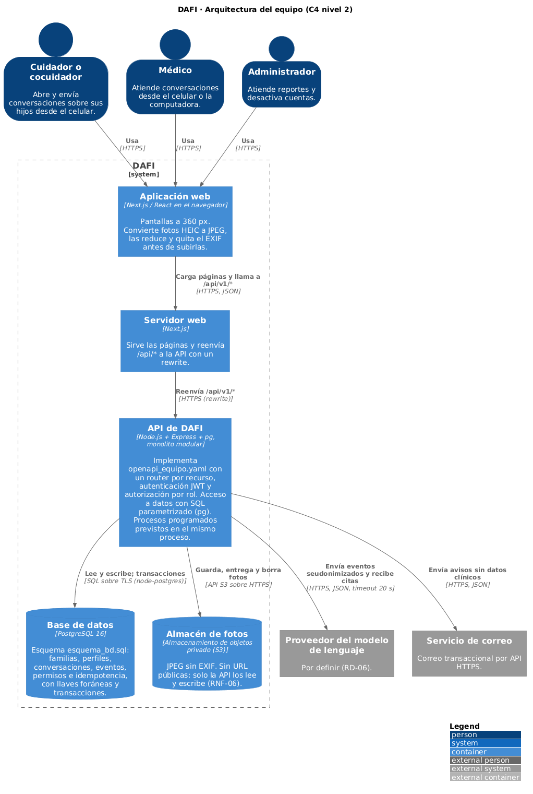

# Arquitectura del equipo: DAFI

**Curso:** (TC5062.10) Análisis, diseño y construcción de software
**Equipo 4:** Armando Arredondo Valle (A01424709), Isaac González Trejo (A01274193), Francisco Martínez Álvarez (A01840483) y Daniel Ruán Aguilar (A01731921)
**Actividad:** S05-S06-A1, Parte 0
**Estado:** acordada. Los ADR individuales de Francisco, Isaac y Daniel (S04-A1) eligieron por separado el mismo estilo; las diferencias y su resolución están en `diferencias_diseno.md`, sección 3.

## Estilo

Cliente-servidor con la API como **monolito modular** (ADR-001 de S04-A1): el cliente Next.js reenvía `/api/*` a una sola API Express, organizada en módulos que siguen las épicas del SRS (identidad, familias, perfiles, conversaciones, contexto, notificaciones, administración y catálogos). El contrato de la API es `openapi_equipo.yaml`.

El único cambio de fondo frente a los diseños individuales es la base de datos, que pasa de MongoDB a PostgreSQL (ADR-002, abajo).

## Diagrama de contenedores

Fuente: `arquitectura_equipo.puml` (C4, nivel 2). Imagen: `imagenes/arquitectura_equipo.png`.

## ADR-002: PostgreSQL en lugar de MongoDB

**Fecha:** 2026-10-24
**Estado:** Propuesto (pendiente de confirmar en el chat del equipo)
**Sustituye:** la restricción tecnológica de base de datos del SRS 2.4 y la tarea T-06 del Sprint 1 (MongoDB Atlas y Mongoose).

**Contexto.** Desde `S02_A1/proyecto_base.md` el equipo usaba MongoDB, y así quedó en el SRS y en las arquitecturas individuales de S04. La actividad S05-S06 pide diseñar e importar un esquema relacional (`CREATE TABLE`, llaves primarias y foráneas, restricciones) en MySQL, PostgreSQL o SQLite. Además, el dominio de DAFI es relacional por naturaleza: familia → perfiles → conversaciones → eventos es una cadena de composición con borrado en cascada (RF-21, RNF-07), y la regla de qué puede ver un médico (SRS 3.0) cruza familias, círculo médico, permisos de historial y conversaciones en cada lectura.

**Decisión.** PostgreSQL 16 como base de datos, con node-postgres (`pg`) y SQL parametrizado en los repositorios de cada módulo. Next.js, Express y el estilo de monolito modular no cambian.

Descartamos un ORM como Prisma: el esquema usa triggers, vistas, índices parciales y llaves foráneas compuestas que Prisma no modela completos, y con `pg` el archivo `esquema_bd.sql` sigue siendo la única fuente de verdad del esquema.

**Alternativas consideradas.**

| Alternativa | Por qué no |
|---|---|
| Mantener MongoDB | No cumple lo que pide la actividad (esquema relacional importado) y deja sin llaves foráneas la integridad que el SRS exige en la cascada de borrado y en la regla de visibilidad. |
| MySQL | Viable, pero PostgreSQL trae de fábrica lo que el diseño ya usa: `gen_random_uuid()` para las llaves UUID que ya proponía la especificación de Daniel, `CHECK` y tipos `ENUM` para los estados del SRS, e índices parciales. |
| SQLite | No tiene servidor; con el disco efímero del hosting gratuito de la API, los datos se perderían en cada despliegue. Sirve para pruebas, no para el ambiente del curso. |

**Consecuencias.**
- Las llaves foráneas y las transacciones son nativas: el borrado de una familia (RF-21-AC-4) se resuelve con `ON DELETE CASCADE` y el envío de una conversación con una transacción, sin depender de un *replica set*.
- La regla de visibilidad se expresa como consultas con `JOIN` sobre tablas con índices, en lugar de varias lecturas de documentos.
- Hay que actualizar la restricción 2.4 del SRS y rehacer la tarea T-06 (Atlas y Mongoose) con PostgreSQL y `pg`. Las pruebas de API usarán una base de PostgreSQL de prueba en lugar de MongoDB en memoria.
- Para la entrega de S05-S06 la base corre local (PostgreSQL 16 o Docker). El servicio de Postgres en la nube para el ambiente del curso queda por decidir.
- El contrato cambia poco: los identificadores pasan a UUID (`components/schemas/Id`) y la versión para `ETag` sale de una columna `version`.

## Implementación en S05-S06

La especificación y el esquema cubren todo el SRS; el código de `backend/` implementa por ahora las entidades principales. La API sigue el estilo acordado con una granularidad más sencilla que la del diseño: un *router* de Express por recurso, en lugar de un módulo con capas por épica, con la autenticación y la autorización centralizadas en dos middlewares.

| Pieza | Archivo | Qué cubre |
|---|---|---|
| Arranque y montaje | `backend/src/server.js`, `backend/src/app.js` | Valida `JWT_SECRET` al arrancar, identificador de correlación, rutas públicas y protegidas bajo `/api/v1`, contrato de errores. |
| Acceso a datos | `backend/src/config/database.js` | Pool de PostgreSQL (`pg`) con SQL parametrizado. |
| Catálogos y salud (públicas) | `backend/src/routes/catalogos.js` | `GET /salud`, `/etiquetas`, `/avisos/{codigo}`. |
| Autenticación | `backend/src/routes/auth.js`, `backend/src/middleware/authenticate.js` | `POST /auth/register`, `POST /auth/login`, `GET /auth/me`; JWT HS256 con `jti` guardado en `sesion` e inactividad (RNF-05). |
| Autorización | `backend/src/middleware/authorize.js` | Rol primero (403) y pertenencia después (404), según la matriz 3.0 del SRS; el médico no ve borradores ni conserva acceso al salir del círculo. |
| Recursos | `backend/src/routes/familias.js`, `perfiles.js`, `conversaciones.js` | Familias, CRUD de perfiles, conversaciones (historial, apertura, edición del borrador, borrado, eventos, envío y mensajes). |

Quedan fuera por ahora la máquina de estados completa, las fotos, el resumen con IA, las notificaciones y los procesos programados (cierre automático y aviso por falta de respuesta), que el diseño ubica dentro del mismo proceso de la API.

La imagen PNG incluida arriba también está disponible como [SVG](imagenes/arquitectura_equipo.svg).

## Flujo de autenticación y autorización en A2

1. El cliente envía `POST /api/v1/auth/register` con los datos de cuenta y consentimientos. Express valida los campos, comprueba unicidad y guarda el hash con `bcryptjs`; la respuesta de registro es pública y no incluye password ni hash.
2. `POST /api/v1/auth/login` compara el password con bcryptjs y, si es válido, firma un JWT HS256 con `sub`, `rol`, `familiaId`, `jti`, `issuer`, `audience` y expiración. La sesión se registra en PostgreSQL. El secret y la expiración se configuran por entorno.
3. El cliente envía `Authorization: Bearer <token>` a `/api/v1/auth/me` o a una ruta protegida. `authenticate` verifica firma, algoritmo, issuer, audience, claims y expiración, además de consultar sesión y usuario activos.
4. `authorize` evalúa rol, familia y visibilidad. Token ausente/inválido responde 401; rol sin permiso, 403; recurso ajeno o no visible puede responder 404.
5. Para médicos, el código final oculta conversaciones en borrador y comprueba que el médico siga en el círculo familiar; salir del círculo corta el acceso en solicitudes posteriores.

## Flujo CRUD protegido

`backend/src/app.js` monta health, catálogos y autenticación pública antes de la cadena de CRUD. Familias, perfiles y conversaciones pasan por `authenticate` y `authorize` antes de sus routers. La autorización aplica los permisos de la matriz de roles y la pertenencia al recurso; después, las rutas ejecutan SQL parametrizado por `pg`. Los errores se serializan mediante el manejador común de Express como JSON con `codigo`, `mensaje` y `correlacionId`; la aplicación también propaga `X-Correlation-Id` en la respuesta.

## Persistencia y configuración local

PostgreSQL conserva cuentas, familias, perfiles, conversaciones, sesiones y relaciones descritas en `esquema_bd.sql`. `backend/src/config/database.js` configura un pool `pg`; `dotenv` carga la configuración local. `backend/.env.example` enumera `PORT`, `DB_HOST`, `DB_PORT`, `DB_NAME`, `DB_USER`, `DB_PASSWORD`, `JWT_SECRET`, `JWT_EXPIRATION` y `MINUTOS_SESION`. El archivo `.env` local no debe versionarse. El backend usa por defecto el puerto HTTP 4000 y requiere PostgreSQL local preparado con el esquema y datos ficticios.

## Trazabilidad de los artefactos

- `openapi_equipo.yaml`: contrato de recursos, requests, respuestas y seguridad Bearer; funciona como especificación, no como prueba de que todas las operaciones estén implementadas.
- `diagrama_clases_equipo.puml`: modelo de dominio y clases.
- `arquitectura_equipo.puml` y `imagenes/arquitectura_equipo.png` / `imagenes/arquitectura_equipo.svg`: vista C4 de contenedores del estilo acordado.
- `esquema_bd.sql`: estructura PostgreSQL y restricciones.
- `backend/src/app.js`, `backend/src/routes/`, `backend/src/middleware/`, `backend/src/config/` y `backend/src/utils/`: montaje HTTP, endpoints implementados, controles y acceso a datos.
- `backend/postman/`: colecciones de solicitudes manuales.
- `S05_S06_A2/evidencia/pruebas_terminal_daniel.md`: evidencia sanitizada de las 15 solicitudes terminales ejecutadas independientemente antes de integrar el último arreglo de `origin/main`.
- `S05_S06_A2/evidencia/pruebas_terminal.sh` y `pruebas_terminal_salida.txt`: evidencia adicional incorporada por el PR #53; no se atribuye a las pruebas independientes anteriores.

## Limitaciones de la implementación actual

- El backend implementa solo una parte de las operaciones descritas por OpenAPI/SRS; no se declara cobertura completa.
- No se observó rate limiting/bloqueo de intentos de login ni el endpoint de cierre de sesión descrito por el contrato.
- La evidencia de las 15 pruebas de Daniel no ejercita específicamente lectura médica de borradores ni la salida del círculo; el comportamiento corregido está en el código integrado desde `origin/main`, con evidencia terminal separada del PR #53.
- CORS está abierto y no se configura TLS en el modo local. El backend es exclusivamente académico, con datos ficticios, y no está listo para producción.
